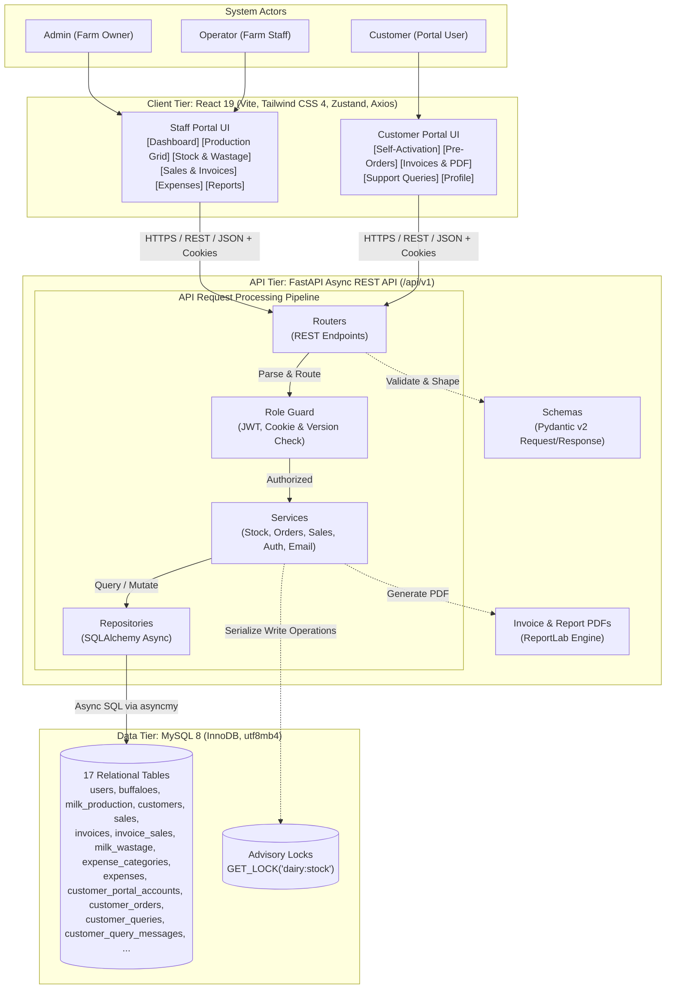
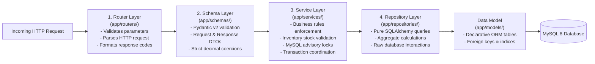
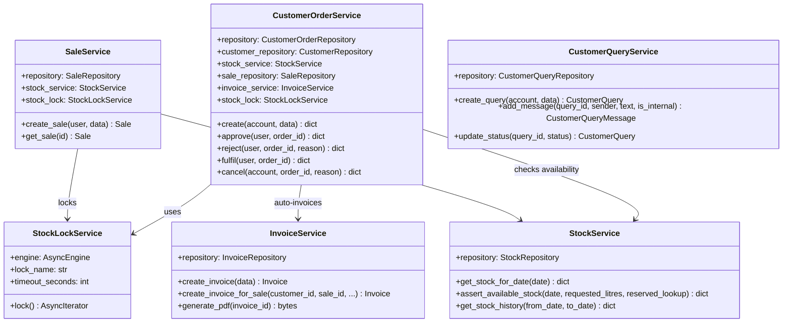
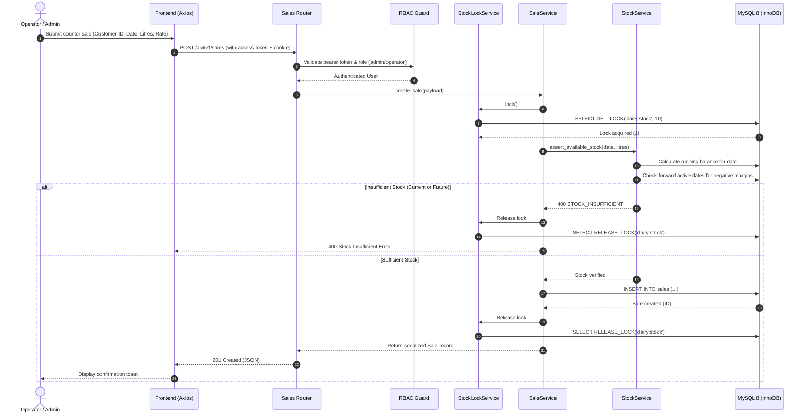
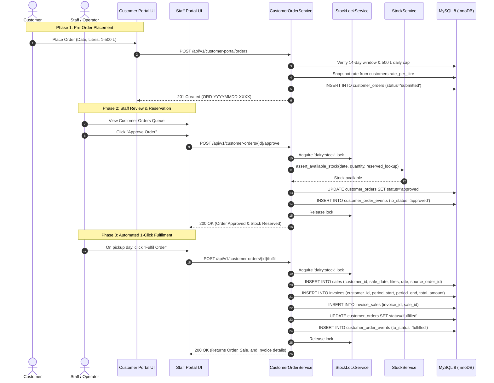
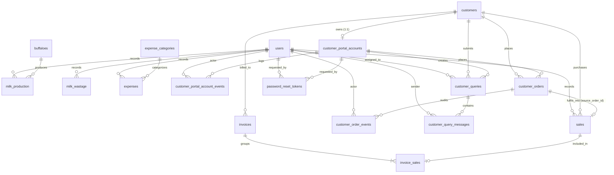
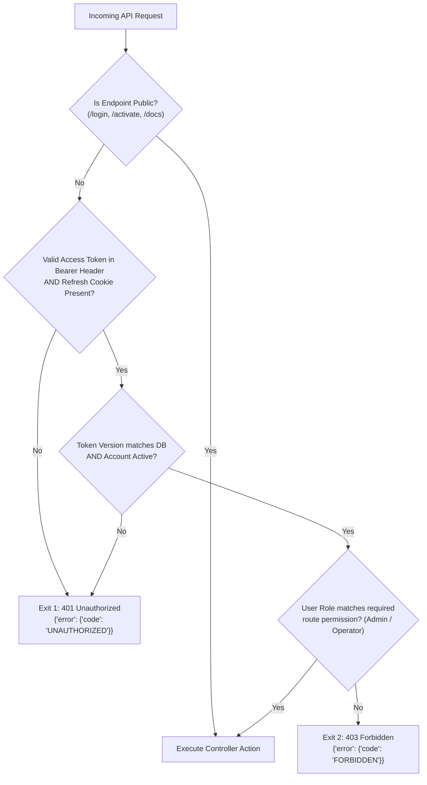

# Dairy Management System

A production-grade, full-stack management platform for a single commercial buffalo dairy farm. Built with a **Python FastAPI** backend, a **React 19** frontend, and **MySQL 8**.

The system provides end-to-end operational workflows for dairy staff (herd tracking, morning/evening milking records, forward-protecting inventory ledger, sales, PDF invoicing, operating expenses, and P&L financial reporting) alongside a dedicated **Customer Self-Service Portal** (account onboarding, online milk orders with stock reservations, billing records, downloadable PDF invoices, and support ticketing).

---

## Table of Contents

1. [Project Overview](#1-project-overview)
2. [Key Features and Implemented Modules](#2-key-features-and-implemented-modules)
3. [Original vs. Extended Functionality](#3-original-vs-extended-functionality)
4. [Technology Stack](#4-technology-stack)
5. [System Architecture and Visual Diagrams](#5-system-architecture-and-visual-diagrams)
   - [3-Tier System Architecture](#3-tier-system-architecture)
   - [Backend 4-Layer Processing Architecture](#backend-4-layer-processing-architecture)
   - [Domain Services and Repositories Class Diagram](#domain-services-and-repositories-class-diagram)
   - [Sequence: Recording a Direct Sale with Stock Locking](#sequence-recording-a-direct-sale-with-stock-locking)
   - [Sequence: Customer Order Lifecycle and 1-Click Fulfilment](#sequence-customer-order-lifecycle-and-1-click-fulfilment)
6. [Project Directory Structure](#6-project-directory-structure)
7. [Frontend and Backend Responsibilities](#7-frontend-and-backend-responsibilities)
8. [User Roles and Permissions (RBAC)](#8-user-roles-and-permissions-rbac)
9. [Database Schema and Relationships](#9-database-schema-and-relationships)
10. [Authentication and Security Model](#10-authentication-and-security-model)
    - [Authentication and Authorization Flow](#authentication-and-authorization-flow)
11. [API Overview and Endpoint Groups](#11-api-overview-and-endpoint-groups)
12. [Installation and Local Development Setup](#12-installation-and-local-development-setup)
13. [Environment Variables Reference](#13-environment-variables-reference)
14. [Database Setup, Migrations, and Seeding](#14-database-setup-migrations-and-seeding)
15. [Running Frontend and Backend Independently](#15-running-frontend-and-backend-independently)
16. [Docker Setup and Deployment (Docker Compose)](#16-docker-setup-and-deployment-docker-compose)
17. [Application URLs and Endpoints](#17-application-urls-and-endpoints)
18. [Testing and Quality Assurance](#18-testing-and-quality-assurance)
19. [Implementation Notes and Operational Constraints](#19-implementation-notes-and-operational-constraints)

---

## 1. Project Overview

The Dairy Management System is engineered for commercial dairy farming operations, specifically structured around Indian dairy practices:
- **Scope:** Single commercial buffalo dairy farm.
- **Currency:** Indian Rupee (**INR / ₹**), stored with exact monetary precision as `DECIMAL(12, 2)`.
- **Unit of Measure:** Milk volume tracked in **Litres (L)** as `DECIMAL(10, 2)`.
- **Timezone:** Indian Standard Time (`Asia/Kolkata`, UTC+05:30).
- **Milking Sessions:** Standard two-session milking schedule (**Morning** and **Evening**).
- **Core Design Objective:** Elimination of manual record keeping, prevention of inventory overselling through transaction-serialized running stock ledgers, automated order fulfilment and invoicing, and complete auditability.

---

## 2. Key Features and Implemented Modules

### Staff Management Modules
- **Herd Lifecycle Management:** Register buffaloes with unique ear-tag identifiers, breed, birth date, purchase date, and lifecycle status (`active`, `dry`, `sold`, `dead`). Track live milking herd counts.
- **Production Grid & Milking Records:** Daily morning and evening milk entries per animal. Features a rapid bulk-entry grid for operators to log the entire milking herd for a given date in one pass.
- **Derived Inventory Ledger & Wastage:** Strict transactional running ledger:
  $$\text{Closing}_d = \text{Opening}_d + \text{Produced}_d - \text{Sold}_d - \text{Wasted}_d \quad (\text{where } \text{Opening}_d = \text{Closing}_{d-1})$$
  Logs spoiled, spilled, or returned milk. Evaluates forward-dated inventory impacts to ensure no historical or current deduction forces any future date's balance below zero.
- **Customer Directory & Pricing:** Customer accounts with individualized rate-per-litre contracts, delivery addresses, phone numbers, and live balance calculations.
- **Direct Sales & PDF Billing:** Daily direct counter sales with instant stock validation. On-demand generation of professional PDF invoices via ReportLab, supporting single-sale receipts and consolidated monthly statements.
- **Operating Expenses & Profit Reporting (Admin Only):** Categorized operational expenses (feed, labour, veterinary medicine, electricity, transport, general). Real-time daily and monthly profit and loss (P&L) calculation with downloadable PDF reports.
- **User Administration & Security:** Admin controls for staff provisioning, role changes, deactivation, and single-use password reset workflows.

### Customer Self-Service Portal
- **Secure Activation & Onboarding:** Staff generates single-use activation credentials (72-hour TTL, SHA-256 token hash). Customers self-activate with their chosen password.
- **Milk Pre-Orders:** Customers schedule milk orders up to 14 days in advance (1.00 L to 500.00 L per order, subject to a 500.00 L daily customer cap). Rate is locked at submission.
- **Stock Reservations:** Approving an order immediately reserves inventory on the requested date without creating physical deductions until fulfilment.
- **1-Click Fulfilment Automation:** Staff fulfils approved pickup orders on the target date; the system automatically creates the corresponding `Sale` record, generates the linked `Invoice`, and advances the order status to `fulfilled`.
- **Support & Ticketing:** Conversational inquiry threads with categorized topics (`billing`, `order`, `delivery`, `account`, `other`). Supports staff internal notes hidden from customers.
- **Customer Financial Hub:** Self-service viewing of outstanding balance, historical orders, and downloadable PDF invoices.

---

## 3. Original vs. Extended Functionality

The repository contains two historical checkpoints across its Git branches: the baseline PRD implementation (`master`) and the expanded enterprise portal release (`feature/customer-portal`).

| Domain | Original PRD / `master` | Extended Implementation (`feature/customer-portal`) | Status in Current Code |
|---|---|---|---|
| **User Roles** | Admin, Operator | Admin, Operator, Customer (external) | Fully Implemented |
| **Customer Access** | None (passive invoice recipients) | Dedicated Customer Self-Service Portal (`/portal/*`) | Fully Implemented |
| **Portal Accounts** | None | Admin provisioning, self-activation token (72 h TTL), audit events | Fully Implemented |
| **Ordering Model** | Counter sales only | Pre-ordering (up to 14 days ahead) with status state machine | Fully Implemented |
| **Inventory Locking** | Standard DB transactions | MySQL advisory locking (`GET_LOCK('dairy:stock')`) + reservation tracking | Fully Implemented |
| **Fulfilment** | Manual sale entry | 1-click staff fulfilment auto-generates linked `Sale` + `Invoice` | Fully Implemented |
| **Customer Support** | None | Multi-message ticketing system with private staff internal notes | Fully Implemented |
| **Notifications** | None (email used as login identifier only) | Asynchronous transactional email (FastAPI `BackgroundTasks` + SMTP) | Fully Implemented |
| **Password Recovery** | Admin-assigned passwords | Self-service email password reset with SHA-256 single-use tokens | Fully Implemented |
| **Session Control** | JWT expiration only | `token_version` tracking on users and customer portal accounts | Fully Implemented |
| **Database Engine** | PRD proposed PostgreSQL/SQLite | Engineered for MySQL 8 (`utf8mb4`) with SQLAlchemy async | Verified Active Engine |

---

## 4. Technology Stack

### Backend (`backend_py/`)
- **Runtime & Language:** Python 3.11+
- **API Framework:** FastAPI `0.162.0` (ASGI server: `uvicorn`)
- **Package & Dependency Manager:** `uv` (`pyproject.toml`, `uv.lock`)
- **ORM & Data Layer:** SQLAlchemy `2.1.6` (Async Engine with `asyncmy` driver)
- **Database Engine:** MySQL 8 (`utf8mb4` character set, InnoDB engine)
- **Database Migrations:** Alembic `1.20.1` (Revisions 0001 through 0006, idempotent)
- **Security & Tokens:** `pyjwt` 2.15.1, `bcrypt` 5.0.0, cryptographic `secrets` module
- **PDF Generation:** ReportLab `5.1.0` (vector drawing, standard fonts, tabular formatting)
- **Email Service:** `emails` 1.1.3 (asynchronous SMTP delivery via FastAPI `BackgroundTasks`)
- **Validation & Serialization:** Pydantic v2
- **Testing & Tooling:** `pytest` 9.2.0, `ruff` 0.17.3

### Frontend (`frontend/`)
- **Runtime:** Node.js (v20+ recommended)
- **Build Tool & Dev Server:** Vite `8.3.5`
- **Framework:** React `19.3.1` + React DOM `19.3.1`
- **Styling:** Tailwind CSS `4.3.3` with `@tailwindcss/vite`
- **Client Routing:** React Router DOM `7.18.5` (SPA client routing)
- **State Management:** Zustand `5.0.16`
- **HTTP Client:** Axios `1.21.0` (Dual client instances: `client.js` and `customerClient.js`)
- **Icons & Alerts:** Lucide React `1.63.0`, React-Toastify `11.1.0`
- **Linting:** ESLint 10 with React compiler & hooks rules

---

## 5. System Architecture and Visual Diagrams

The application directly mirrors and extends the design diagrams from the original Project Requirements Document (PRD):

### System Design (3 Tiers, 4 API Layers — PRD §3)
Every request passes through the presentation tier and authentication/role guards before reaching the business services:



---

### Backend 4-Layer Processing Architecture

Every incoming API request is processed through four isolated backend layers, ensuring zero SQL in routers and zero HTTP semantics in repositories:



---

### Domain Services and Repositories Class Diagram



---

### Sequence: Recording a Direct Sale with Stock Locking

Demonstrates how direct counter sales acquire the global MySQL advisory lock and evaluate current and future date stock availability before committing:



---

### Sequence: Customer Order Lifecycle and 1-Click Fulfilment

Illustrates the end-to-end order workflow from customer pre-order submission, staff stock reservation, and automated 1-click fulfilment generating linked sales and invoices:



---

## 6. Project Directory Structure

```text
dairy_management_system/
├── backend_py/                                # Active FastAPI Backend
│   ├── alembic/                               # Alembic migration environment
│   │   ├── versions/                          # Migration revisions (0001 to 0004)
│   │   └── env.py
│   ├── app/
│   │   ├── core/                              # App config, security, dependencies, errors
│   │   ├── db/                                # Async session and engine management
│   │   ├── models/                            # Declarative SQLAlchemy models (17 tables)
│   │   ├── repositories/                      # Async database query operations
│   │   ├── routers/                           # API endpoints grouped by domain
│   │   ├── schemas/                           # Pydantic v2 schemas
│   │   ├── seeders/                           # Base admin seeder & realistic Indian dataset
│   │   ├── services/                          # Business logic, locks, and calculations
│   │   └── utils/                             # ReportLab PDF builders, time, task helpers
│   ├── tests/                                 # Pytest test suite (350+ tests)
│   ├── .env.example                           # Backend environment template
│   ├── .python-version                        # Python version pin (3.11)
│   ├── alembic.ini                            # Alembic migration configuration
│   ├── pyproject.toml                         # Project metadata and dependencies (uv)
│   ├── README.md                              # FastAPI-specific backend guide
│   └── uv.lock                                # Deterministic dependency lockfile
├── frontend/                                  # Active React 19 Frontend
│   ├── public/                                # Static web assets
│   ├── src/
│   │   ├── api/                               # Dual Axios client configuration
│   │   ├── components/                        # UI controls, modals, tables, route guards
│   │   ├── context/                           # Staff and customer auth providers (Zustand/React)
│   │   ├── hooks/                             # Custom React hooks (useAuth, useCustomerAuth)
│   │   ├── layouts/                           # AppLayout (Staff) and CustomerLayout (Portal)
│   │   ├── pages/                             # Staff pages and customer portal screens
│   │   ├── App.jsx                            # Route tree definition
│   │   └── main.jsx                           # Application entry point
│   ├── .env                                   # Frontend environment config
│   ├── index.html                             # Single page HTML entry
│   ├── package.json                           # Node dependencies and scripts
│   ├── package-lock.json                      # npm lockfile
│   ├── vite.config.js                         # Vite build configuration (React & Tailwind)
│   └── README.md                              # Frontend-specific guide
├── docs/                                      # System Architecture & Development Records
│   ├── architecture-decisions.md              # ADRs for stock concurrency, precision, etc.
│   ├── CUSTOMER_PORTAL_CONTRACT.md            # Frozen customer portal API & schema specification
│   ├── CUSTOMER_PORTAL_DECISIONS.md           # Architecture decision records for the portal
│   ├── CUSTOMER_PORTAL_PROGRESS.md            # Detailed implementation milestone tracking
│   ├── CUSTOMER_PORTAL_UAT_RELEASE.md         # UAT manual runbook and verification guide
│   └── ...                                    # Additional technical specs
├── backend/                                   # Legacy Node.js implementation (inactive, historical)
├── Dairy Management System – Project Requirements Document.md # Baseline PRD specification
├── Dairy Management System – Project Requirements Document.pdf # Original PDF requirements
└── README.md                                  # Root system documentation (this file)
```

---

## 7. Frontend and Backend Responsibilities

### Frontend Responsibilities
- Serve two distinct experiences in a single web bundle:
  - **Staff Operations App (`/dashboard`, `/buffaloes`, `/production`, etc.):** Milking entry, herd management, sales, invoicing, and order/query queues.
  - **Customer Self-Service Portal (`/portal/*`):** Onboarding activation, order placement, PDF bill downloads, and customer inquiries.
- Enforce in-memory token storage with automatic, single-flight token refresh on 401 responses.
- Isolate staff and customer sessions completely via separate Axios clients (`client.js` vs `customerClient.js`).
- Render monetary amounts and milk volumes directly from API two-decimal string representations without floating-point math.

### Backend Responsibilities
- Serve RESTful endpoints under `/api/v1` with uniform response and error shapes.
- Enforce role-based access control (RBAC) and reject unauthorized calls before reaching business services.
- Manage transactional concurrency for milk inventory using MySQL advisory locks (`GET_LOCK`).
- Guarantee forward stock integrity so historical edits never result in negative future balances.
- Generate dynamic PDF invoices and reports using ReportLab.
- Execute transactional email delivery in non-blocking background tasks (`FastAPI.BackgroundTasks`).

---

## 8. User Roles and Permissions (RBAC)

The system enforces strict Role-Based Access Control on every API endpoint. The frontend reflects these permissions by adjusting navigation menus and views.

| Functional Area | Admin | Operator | Customer |
|---|:---:|:---:|:---:|
| **Staff Authentication** (`/api/v1/auth/*`) | Full | Full | No Access |
| **User Administration** (`/api/v1/users/*`) | Full (Create, Deactivate, Delete) | No Access | No Access |
| **Herd Management** (`/api/v1/buffaloes/*`) | Full (Add, Edit, Soft Delete) | Add, Edit, View | No Access |
| **Milk Production** (`/api/v1/production/*`) | Full (Any Date) | Current Day Only | No Access |
| **Inventory & Wastage** (`/api/v1/stock/*`, `.../wastage`) | Full | View Stock, Log Wastage | No Access |
| **Customer Records** (`/api/v1/customers/*`) | Full | Add, Edit, View | No Access |
| **Sales & Billing** (`/api/v1/sales/*`, `.../invoices/*`) | Full | Create, View, Print PDF | No Access |
| **Operating Expenses** (`/api/v1/expenses/*`) | Full | No Access | No Access |
| **Financial Reports & Profit** (`/api/v1/reports/profit`) | Full | No Access | No Access |
| **Production Reports** (`/api/v1/reports/production`) | Full | View Only | No Access |
| **Record Soft Deletion** (`DELETE /api/v1/{resource}/{id}`) | Full | No Access | No Access |
| **Portal Account Provisioning** (`/api/v1/customer-portal-accounts/*`) | Full | View Status Only | No Access |
| **Customer Order Queue** (`/api/v1/customer-orders/*`) | Approve, Reject, Cancel, Fulfil | Approve, Reject, Fulfil (Today) | No Access |
| **Customer Queries (Staff)** (`/api/v1/customer-queries/*`) | Full + Assign Staff | Respond, Update Status | No Access |
| **Customer Portal Features** (`/api/v1/customer-portal/*`) | No Access | No Access | Full (Own Data Only) |

---

## 9. Database Schema and Relationships

The database is built on **MySQL 8** (InnoDB) and managed via Alembic migrations.



### Core Tables Summary
1. `users`: Staff login credentials, role (`admin` or `operator`), active state, `token_version`, and soft delete status.
2. `buffaloes`: Ear tag number (unique), breed, purchase details, lifecycle status (`active`, `sold`, `dry`, `dead`).
3. `milk_production`: Milking ledger entries with a unique composite index on `(buffalo_id, prod_date, session)`.
4. `customers`: Customer name, contact information, and customized base rate per litre.
5. `sales`: Direct sales records linking to customer, date, volume, rate, and optional `source_order_id`.
6. `invoices`: Consolidated or single-sale invoices with unique invoice numbers (`INV-YYYYMMDD-XXXX`), status (`paid`, `unpaid`, `partial`), and amounts.
7. `invoice_sales`: Many-to-one junction mapping sales to invoices.
8. `milk_wastage`: Wastage logs with quantity, date, and reason (`spoiled`, `spilled`, `returned`).
9. `expense_categories`: Admin-managed expense categories (feed, labour, medicine, electricity, etc.).
10. `expenses`: Operational expense entries with date, amount, category, and notes.
11. `customer_portal_accounts`: Customer login credentials, unique 1:1 foreign key to `customers`, activation token hash, and `token_version`.
12. `customer_portal_account_events`: Audit trail for account provisioning, activation, reactivation, and password resets.
13. `customer_orders`: Pre-orders placed by customers with requested date, quantity, rate snapshot, and status (`submitted`, `approved`, `rejected`, `fulfilled`, `cancelled`).
14. `customer_order_events`: Complete state-machine audit log for order transitions.
15. `customer_queries`: Support tickets with category, subject, tracking number (`QRY-YYYYMMDD-XXXX`), and assignment.
16. `customer_query_messages`: Conversational messages within support tickets, including flag `is_internal` for staff-only notes.
17. `password_reset_tokens`: SHA-256 token hashes for single-use staff and customer password recovery (30-minute TTL).

---

## 10. Authentication and Security Model

1. **Dual-Token Architecture:**
   - **Access Token:** Short-lived JWT (default 30 min) held strictly in frontend client memory; never stored in localStorage or sessionStorage.
   - **Refresh Token:** Long-lived JWT (default 8 hours) stored in a secure, `httpOnly` cookie (`dairy_refresh_token` for staff, `dairy_customer_refresh_token` for customers).
   - **Audience & Scope Separation:** Customer tokens carry `scope="customer"` and `aud="customer-portal"`. Staff routes reject customer tokens, and customer routes reject staff tokens.
2. **Session Hinting:**
   - A non-httpOnly flag cookie (`dairy_session` / `dairy_customer_session`) is set to `1` when signed in. The SPA checks this cookie before making unnecessary `/refresh` network requests.
3. **Instant Session Revocation:**
   - The `token_version` column is incremented on password resets or account deactivation, instantly invalidating all previously issued JWTs.
4. **Cryptographic Integrity:**
   - Passwords hashed using `bcrypt` (work factor 10).
   - Single-use tokens (activation and password resets) generated using `secrets.token_urlsafe(32)` and stored as SHA-256 hashes.
5. **Anti-Timing Attack Protection:**
   - Forgot-password endpoints execute email delivery via `FastAPI.BackgroundTasks`, preventing response-time leakage of registered account addresses.
6. **Concurrency Protection:**
   - Stock updates are serialized using MySQL advisory locks (`GET_LOCK`), preventing race conditions when concurrent sales or order fulfilments take place.
7. **Failed-Attempt Cooldown and Lockout:**
   - A burst of **5 wrong passwords** (`LOGIN_COOLDOWN_THRESHOLD`) starts a **5-minute sign-in pause** (`LOGIN_COOLDOWN_MINUTES`) for that account. During the pause the API answers `429 Too Many Attempts`, refuses the attempt without checking the password, and does **not** count it, so hammering the form cannot escalate into a lock.
   - The pause is derived from `failed_login_count` + `failed_login_first_at` stored on the account row — not from an in-memory timer — so it survives a closed tab, a reload, another browser, a backend restart and a redeploy. Browsers get the remaining seconds back on every attempt.
   - On the failure that reaches `LOGIN_LOCKOUT_THRESHOLD` (10) inside `LOGIN_LOCKOUT_WINDOW_MINUTES` (15), the account is deactivated (`locked_at`, `lock_reason = failed_login_attempts`) and every session is revoked. **This lock has no timer:** it never expires on its own, and only an administrator can clear it from the Users or Portal Accounts page. Every lock and unlock is written to the security audit ledger.
   - `LOGIN_LOCKOUT_WINDOW_MINUTES` is only the *counting* window — how far back a burst of failures is measured. It is not a lock duration.
8. **Config-Driven Security Copy:**
   - Every cooldown message, countdown and alert email is composed from `LOGIN_COOLDOWN_MINUTES` and `LOGIN_COOLDOWN_THRESHOLD` at request time. Changing those two values in `backend_py/.env` updates the logged text, the API error message, the login-page countdown and the alert email together, with no code change.
9. **Transactional Email Design:**
   - All transactional mail shares one responsive, table-based shell with inline styles, no external images or scripts: hidden preheader, brand bar with a colour-coded status pill, accent rule, heading, two-column fact table, numbered next steps, tinted callouts (info / success / warning / danger) and a plain-text alternative that mirrors the HTML.

### Login Cooldown and Lockout (staff and customer portal)

Both sign-in surfaces (`/login` and `/portal/login`) share the same rules and the same response contract:

| Event | HTTP | `error.code` | Extra fields |
|---|---|---|---|
| Wrong password before the threshold | `401` | `UNAUTHORIZED` | — |
| Threshold reached, pause running | `429` | `TOO_MANY_ATTEMPTS` | `retry_after_seconds`, `cooldown_minutes`, `cooldown_threshold` (+ `Retry-After` header) |
| Hard lock on reaching `LOGIN_LOCKOUT_THRESHOLD` | `403` | `ACCOUNT_LOCKED` | `lockout_threshold`, `requires_admin_unlock` |

`ACCOUNT_LOCKED` is a terminal state, not a longer cooldown: it carries no `retry_after_seconds`, shows no countdown, and is not cleared by time passing or by a correct password. Only an administrator unlock re-activates the account and resets the failure counter to zero.

Sample 429 body (values follow `.env`, they are not hard-coded):

```json
{
  "error": {
    "code": "TOO_MANY_ATTEMPTS",
    "message": "Too many failed sign-in attempts. Sign-in is paused for 5 minutes after 5 failed attempts. Try again in 3 minutes 12 seconds.",
    "retry_after_seconds": 192,
    "cooldown_minutes": 5,
    "cooldown_threshold": 5
  }
}
```

How the pause survives a closed tab:

1. The count is persisted on the account row when the threshold is hit, so the server keeps refusing attempts even with no browser open.
2. The login page stores only the **deadline** returned by the server in `localStorage` (`dairy:login-cooldown:staff` / `dairy:login-cooldown:customer`), never the password or a token, and derives the countdown from it on mount.
3. Reopening the tab reads that deadline, shows the amber *Sign-in paused* notice with a live `m:ss` countdown, disables the submit button and keeps the form disabled until the clock reaches zero.
4. Even if that storage entry is missing or cleared, the next submit is still refused by the server with a fresh `retry_after_seconds`, which restarts the visible countdown. The server is always authoritative; the stored deadline is display-only.

The cooldown clock starts **when the threshold attempt happens**, not at the first failure of the burst. Without that, five guesses spaced across the window would finish after a pause measured from the first attempt had already expired, and no pause would ever be felt.

### Authentication and Authorization Flow

Matches the PRD authorization flow (`2 checks, 2 error exits`), enhanced with refresh cookie validation and session version checking:



---

## 11. API Overview and Endpoint Groups

All backend endpoints are prefixed with `/api/v1`. Interactive Swagger documentation is available at `/api/v1/docs`.

### Staff Endpoints
- **Authentication:**
  - `POST /api/v1/auth/login` — Staff sign-in
  - `POST /api/v1/auth/refresh` — Refresh access token via httpOnly cookie
  - `POST /api/v1/auth/logout` — Clear session cookies
  - `POST /api/v1/auth/forgot-password` — Request password reset email
  - `GET /api/v1/auth/reset-password/validate` — Validate reset token
  - `POST /api/v1/auth/reset-password` — Finalize password reset
  - `GET /api/v1/auth/me` — Return active staff profile
- **Users:** `GET`, `POST /api/v1/users`, `GET /api/v1/users/{id}`, `PATCH /api/v1/users/{id}/status`, `DELETE /api/v1/users/{id}`
- **Buffaloes:** `GET`, `POST /api/v1/buffaloes`, `GET /api/v1/buffaloes/count`, `GET`, `PUT /api/v1/buffaloes/{id}`, `DELETE /api/v1/buffaloes/{id}`
- **Production:** `GET /api/v1/production`, `GET /api/v1/production/grid`, `GET /api/v1/production/summary`, `POST /api/v1/production` (single or bulk), `DELETE /api/v1/production/{id}`
- **Stock & Wastage:** `GET /api/v1/stock`, `GET /api/v1/stock/history`, `GET`, `POST /api/v1/wastage`, `DELETE /api/v1/wastage/{id}`
- **Customers:** `GET`, `POST /api/v1/customers`, `GET`, `PUT /api/v1/customers/{id}`, `GET /api/v1/customers/{id}/balance`, `DELETE /api/v1/customers/{id}`
- **Sales:** `GET`, `POST /api/v1/sales`, `GET /api/v1/sales/{id}`, `DELETE /api/v1/sales/{id}`
- **Invoices:** `GET`, `POST /api/v1/invoices`, `GET /api/v1/invoices/{id}`, `GET /api/v1/invoices/{id}/pdf`, `PATCH /api/v1/invoices/{id}/payment`, `DELETE /api/v1/invoices/{id}`
- **Expenses:** `GET`, `POST /api/v1/expenses`, `GET /api/v1/expenses/{id}`, `GET`, `POST /api/v1/expenses/categories`, `DELETE /api/v1/expenses/{id}`
- **Reports:** `GET /api/v1/reports/dashboard`, `GET /api/v1/reports/production`, `GET /api/v1/reports/profit` (Admin), `GET /api/v1/reports/pdf` (Admin)
- **Portal Accounts Management:** `GET`, `POST /api/v1/customer-portal-accounts`, `GET /api/v1/customer-portal-accounts/{id}`, `POST /api/v1/customer-portal-accounts/{id}/reactivate`, `POST /api/v1/customer-portal-accounts/{id}/deactivate`, `POST /api/v1/customer-portal-accounts/{id}/reset-activation`
- **Customer Orders Queue:** `GET /api/v1/customer-orders`, `GET /api/v1/customer-orders/{id}`, `POST /api/v1/customer-orders/{id}/approve`, `POST /api/v1/customer-orders/{id}/reject`, `POST /api/v1/customer-orders/{id}/fulfil`, `POST /api/v1/customer-orders/{id}/cancel`
- **Customer Queries Queue:** `GET /api/v1/customer-queries`, `GET /api/v1/customer-queries/{id}`, `POST /api/v1/customer-queries/{id}/messages`, `POST /api/v1/customer-queries/{id}/status`, `POST /api/v1/customer-queries/{id}/assign`

### Customer Endpoints
- **Customer Auth:**
  - `POST /api/v1/customer-auth/activate` — Activate portal account with token
  - `POST /api/v1/customer-auth/login` — Customer login
  - `POST /api/v1/customer-auth/refresh` — Refresh customer access token
  - `POST /api/v1/customer-auth/logout` — Customer sign-out
  - `POST /api/v1/customer-auth/forgot-password` — Customer password reset request
  - `GET /api/v1/customer-auth/reset-password/validate` — Validate reset token
  - `POST /api/v1/customer-auth/reset-password` — Submit new password
  - `GET /api/v1/customer-auth/me` — Return customer profile
- **Customer Portal Services:**
  - `GET /api/v1/customer-portal/dashboard` — Summary KPIs and recent records
  - `GET /api/v1/customer-portal/profile` — View registered customer profile
  - `GET /api/v1/customer-portal/balance` — Current balance
  - `GET`, `POST /api/v1/customer-portal/orders` — List and place milk orders
  - `GET /api/v1/customer-portal/orders/{id}` — Order status and tracking
  - `POST /api/v1/customer-portal/orders/{id}/cancel` — Cancel submitted order
  - `GET /api/v1/customer-portal/invoices` — List customer invoices
  - `GET /api/v1/customer-portal/invoices/{id}` — Invoice details
  - `GET /api/v1/customer-portal/invoices/{id}/pdf` — Download PDF invoice
  - `GET`, `POST /api/v1/customer-portal/queries` — List and create support queries
  - `GET /api/v1/customer-portal/queries/{id}` — View ticket conversation
  - `POST /api/v1/customer-portal/queries/{id}/messages` — Reply to ticket

---

## 12. Installation and Local Development Setup

### Prerequisites
- **Python:** 3.11 or higher
- **Node.js:** v20 or higher, with `npm`
- **Database:** MySQL 8.x running locally or in Docker
- **Package Manager:** `uv` installed (`pip install uv` or via standalone installer)

### 1. Database Setup
Create an empty database with `utf8mb4` encoding in MySQL:
```sql
CREATE DATABASE dairy_db CHARACTER SET utf8mb4 COLLATE utf8mb4_unicode_ci;
```

### 2. Backend Setup
```bash
# Navigate to the backend directory
cd backend_py

# Sync virtual environment and install locked dependencies
uv sync

# Configure environment variables
cp .env.example .env
# Edit .env to set your MySQL credentials (DB_USER, DB_PASSWORD, DB_PORT, etc.)

# Apply database migrations
uv run alembic upgrade head

# Seed initial admin and expense categories
uv run python -m app.seeders.base_seed

# Optional: Seed realistic Indian demo data (buffaloes, production, customers, portal accounts)
uv run python -m app.seeders.fake_indian_data

# Start FastAPI development server
uv run uvicorn app.main:app --reload --port 8000
```

### 3. Frontend Setup
```bash
# In a new terminal, navigate to the frontend directory
cd frontend

# Install dependencies
npm install

# Configure environment variables (if overriding defaults)
# VITE_API_BASE_URL defaults to http://localhost:8000/api/v1

# Start Vite development server
npm run dev
```

---

## 13. Environment Variables Reference

### Backend (`backend_py/.env`)

| Variable | Default / Example | Purpose |
|---|---|---|
| `PORT` | `8000` | Port for Uvicorn ASGI server |
| `NODE_ENV` | `development` | Environment mode (`development`, `production`, `staging`) |
| `TZ` | `Asia/Kolkata` | Standard operational business timezone |
| `CORS_ORIGINS` | `http://localhost:5173,http://localhost:3000` | Allowed origins for cross-origin credentials |
| `DB_DIALECT` | `mysql` | SQLAlchemy dialect |
| `DB_HOST` | `localhost` | MySQL host address |
| `DB_PORT` | `3306` (or `3307`) | MySQL port |
| `DB_NAME` | `dairy_db` | MySQL database name |
| `DB_USER` | `root` | Database username |
| `DB_PASSWORD` | `your_password` | Database password |
| `DB_LOGGING` | `false` | Enable/disable SQL query echo logging |
| `DB_POOL_SIZE` | `10` | SQLAlchemy connection pool size |
| `DB_MAX_OVERFLOW` | `0` | Extra connections allowed above the pool size |
| `DB_POOL_TIMEOUT` | `30` | Seconds to wait for a free pooled connection |
| `DB_POOL_RECYCLE` | `1800` | Recycle pooled connections this many seconds after checkout |
| `JWT_SECRET` | `minimum_32_characters_secret` | Secret key for signing staff JWTs |
| `ACCESS_TOKEN_EXPIRE_MINUTES` | `30` | Access token lifetime in minutes |
| `REFRESH_TOKEN_EXPIRE_MINUTES` | `480` | Refresh token lifetime (8 hours) |
| `REFRESH_COOKIE_NAME` | `dairy_refresh_token` | Name of the httpOnly staff refresh cookie |
| `REFRESH_COOKIE_PATH` | `/api/v1` | Cookie path; widened automatically if narrower than the API prefix |
| `REFRESH_COOKIE_DOMAIN` | `""` | Cookie domain; empty means the current host |
| `REFRESH_COOKIE_SAMESITE` | `lax` | `lax`, `strict` or `none` (none requires a secure cookie) |
| `REFRESH_COOKIE_SECURE` | `""` | Empty auto-enables it when `NODE_ENV=production` |
| `SESSION_HINT_COOKIE_NAME` | `dairy_session` | Secret-free cookie the SPA checks before probing `/auth/refresh` |
| `BODY_LIMIT_BYTES` | `1048576` | Maximum accepted request body size |
| `BCRYPT_ROUNDS` | `10` | Password hashing cost |
| `ADMIN_NAME` | `System Admin` | Full name for bootstrap administrator |
| `ADMIN_USERNAME` | `admin` | Username for bootstrap administrator |
| `ADMIN_EMAIL` | `admin@dairyfarm.com` | Login email for bootstrap administrator |
| `ADMIN_PASSWORD` | `AdminSecurePass123` | Password for bootstrap administrator |
| `CUSTOMER_JWT_SECRET` | `distinct_32_char_secret` | Distinct signing key for customer tokens |
| `CUSTOMER_REFRESH_COOKIE_NAME` | `dairy_customer_refresh_token` | Name of the httpOnly customer refresh cookie |
| `CUSTOMER_SESSION_HINT_COOKIE_NAME` | `dairy_customer_session` | Secret-free cookie the customer SPA checks before refreshing |
| `CUSTOMER_ACTIVATION_TTL_HOURS` | `72` | Activation token validity duration |
| `CUSTOMER_ORDER_MIN_LITRES` | `1.00` | Minimum milk order volume |
| `CUSTOMER_ORDER_MAX_LITRES` | `500.00` | Maximum volume per single order |
| `CUSTOMER_ORDER_DAILY_CAP_LITRES` | `500.00` | Maximum aggregate daily orders per customer |
| `CUSTOMER_ORDER_WINDOW_DAYS` | `14` | Order scheduling advance window |
| `FRONTEND_URL` | `http://localhost:5173` | Base frontend URL for email link generation |
| `SMTP_HOST` | `127.0.0.1` | SMTP server host (e.g. Mailpit or hosted SMTP) |
| `SMTP_PORT` | `1025` | SMTP port |
| `SMTP_USER` | `""` | SMTP username |
| `SMTP_PASSWORD` | `""` | SMTP password |
| `SMTP_USE_TLS` | `false` | Enable STARTTLS (typical for port 587) |
| `SMTP_USE_SSL` | `false` | Enable implicit SSL (typical for port 465); enable at most one of TLS/SSL |
| `SMTP_TIMEOUT_SECONDS` | `10` | Socket timeout for SMTP conversations |
| `MAIL_FROM_EMAIL` | `no-reply@dairyfarm.com` | Sender address for transactional emails |
| `MAIL_FROM_NAME` | `AmritDhara Dairy` | Sender display name |
| `PASSWORD_RESET_TTL_MINUTES` | `30` | Password reset link validity duration |
| `LOGIN_COOLDOWN_THRESHOLD` | `5` | Wrong passwords that start the temporary sign-in pause |
| `LOGIN_COOLDOWN_MINUTES` | `5` | Length of the sign-in pause; embedded in the 429 message and the login-page countdown |
| `LOGIN_LOCKOUT_THRESHOLD` | `10` | Counted failures that hard-lock the account; the lock has no timer and only an administrator can clear it |
| `LOGIN_LOCKOUT_WINDOW_MINUTES` | `15` | Counting window for a burst of failures; it never expires a lock |
| `FAILED_LOGIN_ALERT_ENABLED` | `true` | Send the failed-sign-in alert email |
| `FAILED_LOGIN_ALERT_THRESHOLD` | `5` | Failures in the window before the alert email is sent |
| `FAILED_LOGIN_ALERT_WINDOW_MINUTES` | `15` | How far back the alert email counts attempts |
| `FAILED_LOGIN_ALERT_COOLDOWN_MINUTES` | `15` | Minimum gap between two alert emails for the same account |

Every variable above is also passed through to the container by the `environment:` block in `docker-compose.yaml`, with the same default, except two that Docker has to choose differently: `DB_HOST` is always `db` (the service name), and `SMTP_HOST` defaults to empty so mail stays disabled until you point it at a reachable server. Variables that only exist for Compose (`RUN_MIGRATIONS`, `RUN_SEED`, `DB_WAIT_*`, host ports) are listed in [section 16](#16-docker-setup-and-deployment-docker-compose).

### Frontend (`frontend/.env`)

| Variable | Default / Example | Purpose |
|---|---|---|
| `VITE_API_BASE_URL` | `http://localhost:8000/api/v1` | Target FastAPI backend base URL |
| `VITE_SESSION_HINT_COOKIE` | `dairy_session` | Name of the staff session indicator cookie |
| `VITE_CUSTOMER_SESSION_HINT_COOKIE` | `dairy_customer_session` | Name of the customer session indicator cookie |

---

## 14. Database Setup, Migrations, and Seeding

Database migrations are managed using Alembic inside `backend_py/`.

### Migration Commands
```bash
cd backend_py

# Check current revision status
uv run alembic current

# Upgrade schema to the latest revision (0001 -> 0006)
uv run alembic upgrade head

# Rollback one migration revision
uv run alembic downgrade -1
```

Every revision is idempotent: it creates only the tables, columns, indexes and
foreign keys that are missing (`app/db/migration_helpers.py`). Running
`alembic upgrade head` again — on a fresh volume, on the legacy Sequelize
database, or after an interrupted run — is a no-op instead of failing with
"table already exists", "duplicate column name" or "duplicate key name". The
Docker image does this automatically at startup; see
[section 16](#16-docker-setup-and-deployment-docker-compose).

### Seeding Scripts
- **Base Seeder:** Creates the 6 standard PRD expense categories (`feed`, `labour`, `medicine`, `electricity`, `transport`, `other`) and boots the initial `Admin` user defined in `.env`.
  ```bash
  uv run python -m app.seeders.base_seed
  ```
- **Demo Data Seeder (Indian Dairy Dataset):** Generates realistic breeds (`Murrah`, `Surti`, `Mehsana`, etc.), active and dry buffaloes, historical morning/evening milking records, customer records, counter sales, invoices, active portal accounts, and sample support queries.
  ```bash
  uv run python -m app.seeders.fake_indian_data
  ```

---

## 15. Running Frontend and Backend Independently

To run the application natively on a developer machine:

1. **Start MySQL 8:** Ensure MySQL 8 is running on the port configured in `.env` (default: `3306` or `3307`).
2. **Launch Backend:**
   ```bash
   cd backend_py
   uv run uvicorn app.main:app --reload --port 8000
   ```
   The backend API will be live at `http://localhost:8000`.
3. **Launch Frontend:**
   ```bash
   cd frontend
   npm run dev
   ```
   The frontend will be available at `http://localhost:5173`.

---

## 16. Docker Setup and Deployment (Docker Compose)

The complete Dairy Management System can be launched using Docker Compose without needing local Python or Node installations.

### Architecture in Docker
- **`db`:** Official MySQL 8 image (`mysql:8.0`), persistent data volume (`dairy_mysql_data`), internal health check (`mysqladmin ping`).
- **`backend`:** Python 3.11 Alpine container running Uvicorn ASGI server on port `8000`. It starts through `docker-entrypoint.sh`, which waits for MySQL, applies the idempotent Alembic migrations, ensures the base seed data, and then execs Uvicorn.
- **`frontend`:** Multi-stage production build running on Alpine Nginx on port `80` (or mapped to `5173` / `80`).

---

### Step-by-Step Setup Guide

#### Step 1: Prepare Environment Files
Docker Compose reads a `.env` file **in the project root** (or variables from your shell) and substitutes them into the `environment:` block of `docker-compose.yaml`. It does **not** read `backend_py/.env` — that file is for running the API natively and is excluded from the image by `.dockerignore`.

Every variable has a working default in `docker-compose.yaml`, so a first `docker compose up` needs no `.env` at all. To override anything, create a root `.env` containing only the overrides you care about — do not copy `backend_py/.env.example` there, its first line is a `[TEMPLATE]` marker and its `DB_HOST`/`DB_PORT`/SMTP values target a native install:
```ini
# .env (project root) - docker compose only
# DB_PASSWORD must match DB_ROOT_PASSWORD: the backend connects as root, and
# the db health check authenticates as root too.
DB_ROOT_PASSWORD=change-me
DB_PASSWORD=change-me
JWT_SECRET=<32+ random characters>
CUSTOMER_JWT_SECRET=<different 32+ random characters>
ADMIN_PASSWORD=change-me
# A mail container on dairy_network. Do not use 127.0.0.1 here: inside the
# backend container that is the container itself, not your host.
SMTP_HOST=mailpit
```
*(In Docker Compose, the database host is automatically routed to the `db` service container, so leave `DB_HOST` alone — it is not read from the root `.env`.)*

#### Compose-only Variables
These control the containers themselves and are not read by the API when it runs natively. Set them in the root `.env` or in front of the command; the default works for a normal first setup.

| Variable | Default | Purpose |
|---|---|---|
| `RUN_MIGRATIONS` | `true` | Run `alembic upgrade head` at container start. Set `false` when you manage the schema yourself. |
| `RUN_SEED` | `true` | Ensure the base seed data (admin user, expense categories) at container start. |
| `DB_WAIT_ATTEMPTS` | `60` | Connection probes before giving up on MySQL. Each probe is `DB_WAIT_INTERVAL` seconds apart. |
| `DB_WAIT_INTERVAL` | `2` | Seconds between probes; total budget is `DB_WAIT_ATTEMPTS x DB_WAIT_INTERVAL`. |
| `FRONTEND_PORT` | `5173` | Host port mapped to the Nginx container (80). |
| `BACKEND_PORT` | `8000` | Host port mapped to Uvicorn (8000). |
| `DB_PORT` | `3306` | Host port mapped to MySQL (3306). |
| `DB_ROOT_PASSWORD` | `root` | MySQL root password used by the `db` service and its health check. |
| `DB_NAME` | `dairy_db` | Database created on first start and used by the backend. |
| `VITE_API_BASE_URL` | `/api/v1` | API prefix baked into the frontend bundle. |
| `SESSION_HINT_COOKIE_NAME` | `dairy_session` | Read by the backend *and* baked into the frontend build so both agree on the cookie name. |
| `CUSTOMER_SESSION_HINT_COOKIE_NAME` | `dairy_customer_session` | Same, for the customer portal cookie. |

Changing `SESSION_HINT_COOKIE_NAME` / `CUSTOMER_SESSION_HINT_COOKIE_NAME` or `VITE_*` requires a frontend rebuild (`docker compose up -d --build frontend`) because they are compile-time Vite values.

#### Step 2: Build and Start Containers
From the project root directory, build and launch all containers in detached mode:
```bash
docker compose up -d --build
```

#### Step 3: Verify Container Health
Check that all three containers (`db`, `backend`, `frontend`) are up and running:
```bash
docker compose ps
```

#### Step 4: Migrations and Seed Data (Automatic)
No manual step is required. `docker-entrypoint.sh` inside the backend image waits for MySQL, runs `alembic upgrade head` and ensures the base seed data (admin user, expense categories) before starting Uvicorn. Watch it happen with:
```bash
docker compose logs -f backend
```

Migrations are idempotent, so restarting the stack or re-running them on an existing volume never fails with "table already exists" or "duplicate column name".

To run them by hand (the virtualenv is already on `PATH`; do **not** prefix with `uv run`, the image does not ship `uv.lock`):
```bash
docker compose exec backend alembic current
docker compose exec backend alembic upgrade head
docker compose exec backend python -m app.seeders.base_seed
```

*(Optional)* Seed the rich Indian dairy demo dataset:
```bash
docker compose exec backend python -m app.seeders.fake_indian_data
```

To skip the automatic steps, start the stack with `RUN_MIGRATIONS=false` / `RUN_SEED=false`:
```bash
RUN_MIGRATIONS=false docker compose up -d
```

#### Step 5: Access the Application
Open your browser to:
- **Staff & Customer Web App:** `http://localhost:5173` (or `http://localhost:80` depending on port mapping)
- **FastAPI Interactive Docs:** `http://localhost:8000/api/v1/docs`
- **Backend Health Probe:** `http://localhost:8000/health`

---

### Useful Docker Management Commands

| Command | Action |
|---|---|
| `docker compose up -d` | Start all services in background |
| `docker compose up -d --build` | Rebuild images and start all services |
| `docker compose logs -f` | Follow live container logs across all services |
| `docker compose logs backend -f` | Follow live logs from the backend API |
| `docker compose ps` | View status and health checks of all containers |
| `docker compose restart backend` | Restart only the FastAPI backend container |
| `docker compose down` | Stop and remove containers (preserves database data) |
| `docker compose down -v` | Stop containers and **delete all database volumes** (fresh start) |

---

### Troubleshooting a First Setup

| Symptom | Cause and fix |
|---|---|
| `Can't connect to MySQL server on 'db'` | MySQL was still initialising. The entrypoint retries for up to 2 minutes (`DB_WAIT_ATTEMPTS`, default 60 attempts of 2s). Raise it on a slow disk, or check `docker compose logs db`. |
| `Table 'users' already exists` / `duplicate column name` | Only possible on a database that was migrated before this hardening. The current revisions probe the schema first, so `docker compose exec backend alembic upgrade head` now completes. If it still fails, the volume holds a partial manual schema: `docker compose down -v` and start again. |
| `dependency failed to start: container dairy_db is unhealthy` | The database never passed its health check. `docker compose logs db` shows the reason (usually insufficient disk or a port clash on 3306). |
| `No module named alembic` inside the container | The command was prefixed with `uv run`, which tries to resolve dependencies without `uv.lock`. Drop the prefix. |
| `Can't locate revision identified by '...'` | The volume was stamped with a revision id that no longer exists in `backend_py/alembic/versions/`. Check `backend_py/alembic heads`, then either `docker compose down -v` for a fresh dev database or `docker compose exec backend alembic stamp head` if the schema really is current. |
| Schema looks wrong after pulling new revisions | `docker compose exec backend alembic current` should equal `alembic heads`. A missing revision means the entrypoint did not run; restart the backend container. |

---

## 17. Available Application URLs and Endpoints

| Service / Interface | URL | Description |
|---|---|---|
| **Public Landing Page** | `http://localhost:5173/` | Welcome page directing to staff and customer portals |
| **Staff App Login** | `http://localhost:5173/login` | Staff and operator authentication |
| **Customer Portal Login** | `http://localhost:5173/portal/login` | Customer self-service portal authentication |
| **Customer Portal Activation** | `http://localhost:5173/portal/activate` | Token-based account activation |
| **Staff Dashboard** | `http://localhost:5173/dashboard` | Key operational metrics and daily summaries |
| **Customer Dashboard** | `http://localhost:5173/portal` | Customer order, invoice, and balance overview |
| **Backend Root** | `http://localhost:8000/` | FastAPI service greeting and info |
| **API Health Check** | `http://localhost:8000/health` | Service and database connectivity health probe |
| **Interactive API Docs** | `http://localhost:8000/api/v1/docs` | Swagger UI documentation for all endpoints |
| **OpenAPI Specification** | `http://localhost:8000/api/v1/docs/openapi.json` | OpenAPI JSON schema |

---

## 18. Testing and Quality Assurance

### Backend Test Suite (`backend_py/`)
The backend includes extensive automated tests covering calculations, stock reservations, advisory locking, RBAC enforcement, and edge cases:

```bash
cd backend_py

# Execute full test suite
uv run pytest

# Run tests with verbose output
uv run pytest -v

# Run code style and linting checks
uv run ruff check .
```

### Frontend Code Quality (`frontend/`)
```bash
cd frontend

# Run ESLint across React components and hooks
npm run lint

# Validate production build bundle
npm run build
```

---

## 19. Implementation Notes and Operational Constraints

1. **Database Engine Requirement:** The active application relies on MySQL 8 specific constructs (including `SELECT GET_LOCK(:name, :timeout)` and `RELEASE_LOCK` for stock concurrency). It cannot be run on PostgreSQL or SQLite without adapting the locking implementation in `app/services/stock_lock.py`.
2. **Monetary & Measurement Integrity:** All monetary figures and milk litres are stored and manipulated using Python's `Decimal` type (`DECIMAL(12, 2)` and `DECIMAL(10, 2)` respectively). Floating-point conversions are prohibited to prevent rounding drift.
3. **Transactional Boundary:** Order fulfilment, sales recording, and invoice creation are executed within an atomic database transaction enclosed by the advisory stock lock.
4. **Out-of-Scope Features:** As planned in the design specifications, multi-tenancy (multi-farm support), third-party payment gateways, SMS/WhatsApp gateways, and automated milk meter integrations remain intentionally unbuilt to maintain operational simplicity.
